# Hi, I'm Amir Mostafa 👋

### Full-Stack Software Engineer · AI & Agentic Engineering · Web3

Building web applications, backend systems, and modern software workflows.

---

## 👨‍💻 About Me

I'm a **Full-Stack Software Engineer with 4+ years of experience** in web applications, backend systems, and production infrastructure.

My main areas of interest are:

- **Full-Stack Development:** React, Next.js, Node.js, Express.js, Nest.js
- **AI & Agentic Engineering:** LLMs, AI Agents, MCP, RAG, N8N, Agent Skills
- **Web3:** BNB Smart Chain, Wagmi, Reown AppKit, RainbowKit, Chainlink
- **Infrastructure:** Docker, Nginx, AWS EC2, Hetzner
- **Testing:** Jest, React Testing Library, Postman

I enjoy exploring new technologies, learning from others, and improving engineering practices.

---

## 🛠️ Technology Stack

### Languages & Frontend

  
  
  
  
  
  
  

### Backend & Data

### AI, Web3 & Infrastructure

---

## 💼 Experience

- **Visionary 3D** — Full-Stack Developer & Technical Lead
- **Ariana Gostar Spadana** — Full-Stack Developer
- **ToBTC / Laqira Protocol** — Web3 Frontend Developer
- **APSignals** — Full-Stack Developer & Mentor
- **APS Legacy** — Full-Stack Developer & DevOps Assistant
- **Sana** — Frontend Developer

---

## 🎓 Education & Development

**B.Sc. in Computer Engineering — Software**  
Islamic Azad University, Najafabad Branch · 2021 – Present

Selected programs:

- CUBE: Introduction to Artificial Intelligence — University of Isfahan
- Armenia LLM Summer School 2025 — AI9 Startup Campus
- CS50: Introduction to Programming with Python — Harvard University
- Back End Development and APIs — freeCodeCamp
- MERN Stack Web Development Program — APSignals

### 🏆 Programs & Competitions

- **DanaCup Programming Competition — 2nd Place**
- **Tech Journey — Dotin / Khatam University**
- **Rahisho — Iran's National Elites Foundation**

---

## 👨‍🏫 Teaching & Mentoring

At **APSignals**, I progressed from student and intern/co-mentor to developer and mentor.

- Mentored approximately **200 students**
- Contributed to programs with **700+ participants**
- Taught JavaScript, React, Node.js, Express.js, MongoDB, Next.js, testing, APIs, and modern frontend development
- Created course materials, exercises, assessments, and curriculum updates

---

## 📊 GitHub Activity

### Contribution Activity

<!-- BEGIN ACTIVITY-GRAPH -->
<picture>
  <source media="(max-width: 767px)" srcset="activity-graph-mobile.svg">
  
</picture>
<!-- END ACTIVITY-GRAPH -->
